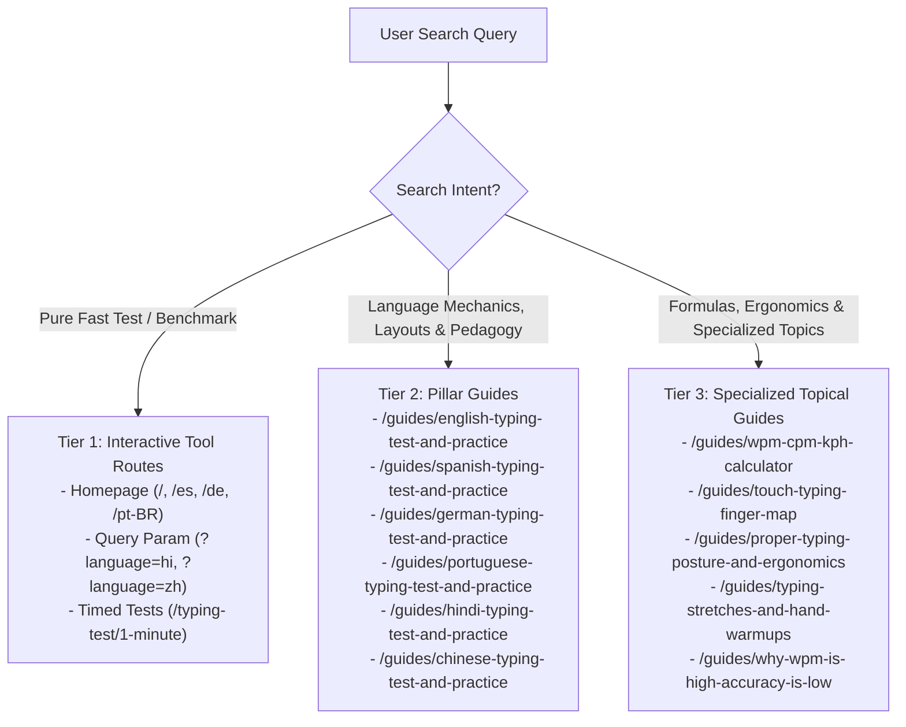

# HeroTyping Multilingual Keyword-to-URL Map & Cannibalization Audit

## 1. Executive Overview

This document defines the authoritative query-to-URL mapping and search intent hierarchy for HeroTyping across the six primary operating languages:
1. **English (`en`)**
2. **Spanish (`es`)**
3. **German (`de`)**
4. **Brazilian Portuguese (`pt-BR`)**
5. **Hindi (`hi`)**
6. **Chinese (`zh` — Simplified Chinese / Pinyin IME)**

---

## 2. Intent Hierarchy & Page Type Matrix

To prevent internal keyword cannibalization between interactive tools, curriculum lessons, and educational guides, queries are segmented into three explicit architectural tiers:

### 2.1 The Two Fundamental Intent Categories
1. **Transactional / Instant Utility Intent**:
   - *Example Queries*: "typing speed test 1 minute", "prueba de mecanografia 1 minuto", "tipptest online 60 sekunden", "teste de digitacao gratis", "hindi typing test online", "中文打字测试 1分钟".
   - *Target URL*: The high-speed interactive typing test canvas.
   - *User Expectation*: Instant keyboard activation, countdown timer, zero required reading before starting.
2. **Informational / Pedagogical / Exam-Specific Intent**:
   - *Example Queries*: "how to type virama and matras in inscript", "zehnfingersystem umlaute tastatur üben", "teclado abnt2 cedilha acentos digitacao", "como escribir la letra ñ en mecanografia", "拼音打字选词技巧 候选栏加速", "test de mecanografia oposiciones administrativo".
   - *Target URL*: The dedicated language pillar guide under `/guides/`.
   - *User Expectation*: Structured anatomical finger charts, exact keyboard layout diagrams, exam speed thresholds, troubleshooting advice, followed by a direct interactive CTA to test their skill.

---

## 3. Query Cluster to Target URL Mapping

### 3.1 English (`en`) Query Clusters

| Cluster Name | Core Search Queries | Target URL | Intent Type | Primary SERP Features |
| :--- | :--- | :--- | :--- | :--- |
| **English Prose Speed Test** | `english typing test online free`, `words per minute test english prose`, `typing practice paragraphs free online` | [`/guides/english-typing-test-and-practice`](https://www.herotyping.com/guides/english-typing-test-and-practice) | Transactional / Practical | Interactive Tool, PAA, Breadcrumb |
| **1-Minute Timed Test** | `typing speed test 1 minute wpm`, `typing speed test 60 seconds without backspace` | [`/typing-test/1-minute`](https://www.herotyping.com/typing-test/1-minute) | Transactional | Interactive Widget, PAA |
| **Beginner Touch Typing** | `touch typing practice for beginners online`, `qwerty keyboard finger placement chart`, `free touch typing lessons order curriculum` | [`/guides/typing-practice-for-beginners`](https://www.herotyping.com/guides/typing-practice-for-beginners) & [`/guides/touch-typing-finger-map`](https://www.herotyping.com/guides/touch-typing-finger-map) | Informational / Practical | Video Pack, Diagrams, PAA |
| **Speed Acceleration & Plateaus** | `how to increase typing speed from 40 to 80 wpm`, `how to set a realistic typing speed goal` | [`/guides/how-to-improve-typing-speed`](https://www.herotyping.com/guides/how-to-improve-typing-speed) | Informational | Featured Snippet, Discussion Forums |
| **Accuracy vs Speed** | `typing accuracy vs speed test`, `typing test net wpm vs gross wpm difference` | [`/guides/why-wpm-is-high-accuracy-is-low`](https://www.herotyping.com/guides/why-wpm-is-high-accuracy-is-low) & [`/guides/net-wpm-vs-gross-wpm`](https://www.herotyping.com/guides/net-wpm-vs-gross-wpm) | Informational | Definition Box, Tables, PAA |
| **Career & Specialized Benchmarks** | `data entry typing test wpm benchmark`, `911 dispatcher typing test practice criticall`, `typing speed test for programmers coding syntax` | [`/guides/data-entry-typing-test`](https://www.herotyping.com/guides/data-entry-typing-test), [`/guides/911-dispatcher-typing-test`](https://www.herotyping.com/guides/911-dispatcher-typing-test), [`/guides/typing-for-programmers`](https://www.herotyping.com/guides/typing-for-programmers) | Career / Practical | Job Board Snippets, Code Blocks |
| **Vocabulary & Orthography** | `english vocabulary typing practice with definitions` | [`/vocabulary`](https://www.herotyping.com/vocabulary) | Practical / Tool | Vocabulary Widgets, PAA |
| **Brand Discovery** | `herotyping english typing test online` | [`/`](https://www.herotyping.com/) | Navigational | Sitelinks, Brand Entity Card |

---

### 3.2 Spanish (`es`) Query Clusters

| Cluster Name | Core Search Queries | Target URL | Intent Type | Primary SERP Features |
| :--- | :--- | :--- | :--- | :--- |
| **Pillar Guide: Teclado Español** | `prueba de mecanografia online gratis`, `practica de mecanografia con teclado espanol`, `como escribir la letra ñ y acentos en mecanografia`, `test de pulsaciones por minuto teclado`, `mecanografia textos largos para practicar` | [`/guides/spanish-typing-test-and-practice`](https://www.herotyping.com/guides/spanish-typing-test-and-practice) | Informational / Practical | Featured Snippet, Diagram, PAA |
| **Spanish Speed Test (Tool)** | `test de velocidad mecanografia 1 minuto`, `prueba de tipeo online español gratis`, `test de velocidad de escritura en computadora` | [`/es`](https://www.herotyping.com/es) | Transactional | Interactive Tool, PAA |
| **Oposiciones & Empleo** | `test de mecanografia oposiciones administrativo`, `examen de mecanografia para empleo administrativo` | [`/guides/spanish-typing-test-and-practice`](https://www.herotyping.com/guides/spanish-typing-test-and-practice) | Career | Exam Circulars, Forum Advice |
| **Spanish Keyboard Mechanics** | `ejercicios de mecanografia fila guia asdf jklñ`, `mecanografia con signos de interrogacion invertidos` | [`/guides/spanish-typing-test-and-practice`](https://www.herotyping.com/guides/spanish-typing-test-and-practice) | Practical | Key Mapping Snippets, PAA |
| **Brand Discovery (ES)** | `herotyping prueba de mecanografia en español` | [`/es`](https://www.herotyping.com/es) | Navigational | Sitelinks, Brand Hub |

---

### 3.3 German (`de`) Query Clusters

| Cluster Name | Core Search Queries | Target URL | Intent Type | Primary SERP Features |
| :--- | :--- | :--- | :--- | :--- |
| **Pillar Guide: Zehnfingersystem & QWERTZ** | `zehnfingersystem lernen kostenlos online`, `tippgeschwindigkeit testen anschläge pro minute`, `schreibtrainer online qwertz tastatur`, `blindschreiben lernen tipps für anfänger`, `tipptest deutsch mit umlauten ä ö ü ß` | [`/guides/german-typing-test-and-practice`](https://www.herotyping.com/guides/german-typing-test-and-practice) | Informational / Practical | Step Snippets, PAA, Diagram |
| **German Speed Test (Tool)** | `tipptest online kostenlos 1 minute`, `schreibtest online 60 sekunden wpm` | [`/de`](https://www.herotyping.com/de) | Transactional | Interactive Tool, PAA |
| **DIN 2137 & Berufsausbildung** | `tastschreiben üben für bürokaufleute prüfung`, `din 2137 schreibgeschwindigkeit anforderungen` | [`/guides/german-typing-test-and-practice`](https://www.herotyping.com/guides/german-typing-test-and-practice) | Career | Standards References, PAA |
| **APM / WPM Umrechnung** | `anschläge pro minute in wörter pro minute umrechnen` | [`/guides/wpm-cpm-kph-calculator`](https://www.herotyping.com/guides/wpm-cpm-kph-calculator) | Tool | Conversion Widget, Formula |
| **Brand Discovery (DE)** | `herotyping tipptest deutsch online` | [`/de`](https://www.herotyping.com/de) | Navigational | Sitelinks, Brand Entity |

---

### 3.4 Brazilian Portuguese (`pt-BR`) Query Clusters

| Cluster Name | Core Search Queries | Target URL | Intent Type | Primary SERP Features |
| :--- | :--- | :--- | :--- | :--- |
| **Pillar Guide: Teclado ABNT2 & Digitação** | `como aprender a digitar rapido com todos os dedos`, `treinar digitacao teclado abnt2 cedilha e acentos`, `teste de velocidade de digitacao toques por minuto`, `curso de digitacao gratuito online sem cadastro` | [`/guides/portuguese-typing-test-and-practice`](https://www.herotyping.com/guides/portuguese-typing-test-and-practice) | Informational / Practical | Step Guide, Keyboard Maps, PAA |
| **Portuguese Speed Test (Tool)** | `teste de digitacao online gratis 1 minuto`, `teste de digitacao 60 segundos palavras por minuto` | [`/pt-BR`](https://www.herotyping.com/pt-BR) | Transactional | Interactive Tool, PAA |
| **Concursos Públicos & Emprego** | `teste de digitacao para concurso publico tribunal`, `teste de digitacao para home office e atendimento` | [`/guides/portuguese-typing-test-and-practice`](https://www.herotyping.com/guides/portuguese-typing-test-and-practice) | Career | Edital Excerpts, Forum Advice |
| **TPM para WPM / Erros** | `converter toques por minuto em palavras por minuto tpm wpm` | [`/guides/wpm-cpm-kph-calculator`](https://www.herotyping.com/guides/wpm-cpm-kph-calculator) | Tool | Formula Snippet, Calculator |
| **Brand Discovery (BR)** | `herotyping teste de digitacao portugues brasil` | [`/pt-BR`](https://www.herotyping.com/pt-BR) | Navigational | Sitelinks, Brand Hub |

---

### 3.5 Hindi (`hi`) Query Clusters

| Cluster Name | Core Search Queries | Target URL | Intent Type | Primary SERP Features |
| :--- | :--- | :--- | :--- | :--- |
| **Pillar Guide: InScript & Mangal Font** | `hindi typing test online free 1 minute`, `inscript hindi typing test mangal font online`, `kruti dev vs inscript layout difference for exams`, `how to type virama halant and matras in hindi inscript`, `mangal font inscript typing keyboard layout map` | [`/guides/hindi-typing-test-and-practice`](https://www.herotyping.com/guides/hindi-typing-test-and-practice) | Informational / Practical | InScript Diagram, Halant Tables, PAA |
| **Interactive Hindi Test (Tool)** | `hindi typing test with accuracy percentage`, `herotyping hindi typing test online` | [`/?language=hi`](https://www.herotyping.com/?language=hi) | Transactional | Interactive Web Application |
| **Govt Exam Benchmarks** | `hindi typing speed test for ssc cgl chsl dest`, `cpct hindi typing test speed benchmark wpm`, `high court ro aro hindi typing speed criteria`, `rajasthan ldc hindi typing test pattern` | [`/guides/hindi-typing-test-and-practice`](https://www.herotyping.com/guides/hindi-typing-test-and-practice) | Career | Exam Notification Cards, PAA |
| **Hindi WPM Formula & Calculation** | `how to calculate hindi typing speed net wpm formula` | [`/guides/wpm-cpm-kph-calculator`](https://www.herotyping.com/guides/wpm-cpm-kph-calculator) | Tool | Formula Box, Exam Rules |

---

### 3.6 Chinese (`zh`) Query Clusters

| Cluster Name | Core Search Queries | Target URL | Intent Type | Primary SERP Features |
| :--- | :--- | :--- | :--- | :--- |
| **Pillar Guide: 拼音盲打与中文测速** | `中文打字速度测试在线 1分钟`, `拼音打字练习平台 免费盲打指法`, `汉字每分钟打字速度标准 cpm 字分`, `双拼输入法练习与全拼打字速度对比`, `如何提升拼音打字选词速度与候选栏效率` | [`/guides/chinese-typing-test-and-practice`](https://www.herotyping.com/guides/chinese-typing-test-and-practice) | Informational / Practical | Standard CPM Tables, IME Guides, PAA |
| **Interactive Chinese Test (Tool)** | `中文打字测速 实时正确率与错字统计`, `在线中文打字测试不用下载软件`, `herotyping 中文打字测试平台` | [`/?language=zh`](https://www.herotyping.com/?language=zh) | Transactional | Interactive Web Application |
| **Career & Clerical Standards** | `文员办公室中文打字速度要求`, `全国计算机等级考试打字测速标准` | [`/guides/chinese-typing-test-and-practice`](https://www.herotyping.com/guides/chinese-typing-test-and-practice) | Career | Exam Benchmarks, HR Requirements |
| **Shuangpin & Punctuation** | `小鹤双拼键盘键位分布与指法练习`, `中文标点符号盲打技巧 顿号破折号书名号` | [`/guides/chinese-typing-test-and-practice`](https://www.herotyping.com/guides/chinese-typing-test-and-practice) | Practical | Key Layout Maps, Symbol Tips |

---

## 4. Cannibalization Audit & Defensive Routing

### 4.1 Localized Homepages vs. Language Guide Pillars
- **Risk**: Search engines may confuse `https://www.herotyping.com/es` (the Spanish interactive tool homepage) with `https://www.herotyping.com/guides/spanish-typing-test-and-practice` (the comprehensive guide).
- **Resolution**:
  1. **Page Title Distinction**:
     - Homepage `/es`: `HeroTyping — Test de Mecanografía y Velocidad de Escritura Online`
     - Pillar Guide: `Test de Mecanografía y Práctica en Teclado Español: Guía Completa de Velocidad y Acentos`
  2. **Schema Separation**:
     - Homepage uses `WebApplication` schema with interactive features.
     - Guide uses `Article` + `FAQPage` schema with structured educational sections.
  3. **H1 & On-Page Headings**:
     - Homepage H1: Direct call to type (interactive canvas).
     - Guide H1: Pedagogical and analytical focus (*¿Cómo mejorar la velocidad y dominar la tecla Ñ?*).

### 4.2 Handling Languages Without Full Localized Route Prefixes (Hindi & Chinese)
- **Architecture**: In HeroTyping, full route internationalization (`LOCALES = ["en", "es", "pt-BR", "de"]`) is strictly limited to locales that have complete UI dictionary translations. Fabricating empty shell subpaths like `/hi/guides/...` or `/zh/guides/...` would lead to duplicate content penalties and poor user experience.
- **Routing Decision**:
  - The educational guide pillars live under the authoritative canonical URL `/guides/hindi-typing-test-and-practice` and `/guides/chinese-typing-test-and-practice`.
  - Transactional search intents point to `https://www.herotyping.com/?language=hi` and `https://www.herotyping.com/?language=zh`.
  - The typing engine natively detects the `language` URL parameter and bootstraps the Devanagari or Chinese word pools and candidate buffer preview immediately.

### 4.3 Anchor Text Matrix for Cross-Linking
When linking internally between guides and the interactive typing engine:

| Source Page | Target Page | Approved Natural Anchor Text |
| :--- | :--- | :--- |
| Spanish Pillar Guide | Homepage `/es` | "Iniciar test de mecanografía en español", "Probar velocidad en español" |
| German Pillar Guide | Homepage `/de` | "Tipptest auf Deutsch starten", "Tippgeschwindigkeit online testen" |
| Portuguese Pillar Guide | Homepage `/pt-BR` | "Iniciar teste de digitação em português", "Testar velocidade no teclado ABNT2" |
| Hindi Pillar Guide | Homepage `/?language=hi` | "Start Hindi Typing Test Online", "ऑनलाइन हिन्दी टाइपिंग टेस्ट शुरू करें" |
| Chinese Pillar Guide | Homepage `/?language=zh` | "立即开始在线中文打字测试", "测试您的拼音打字速度" |
| Any Language Guide | `/guides/wpm-cpm-kph-calculator` | "calculadora de palabras y pulsaciones por minuto", "APM in WPM umrechnen", "convert CPM to WPM" |
| Any Language Guide | `/guides/touch-typing-finger-map` | "mapa de dedos en el teclado", "Fingerpositionen Zehnfingersystem", "mapa de digitação" |
